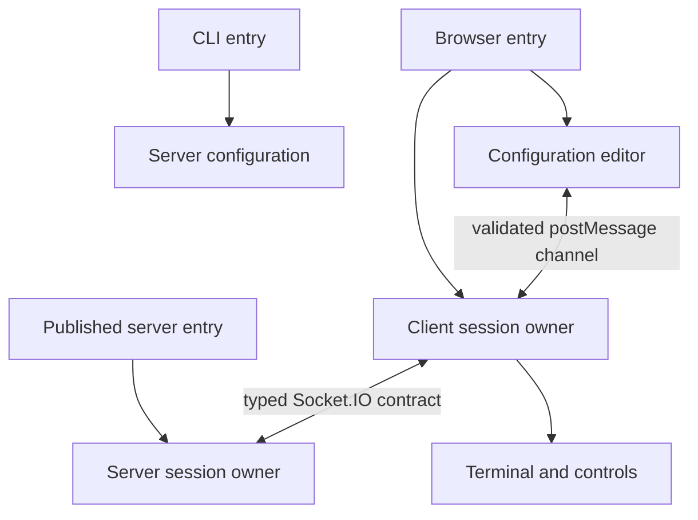
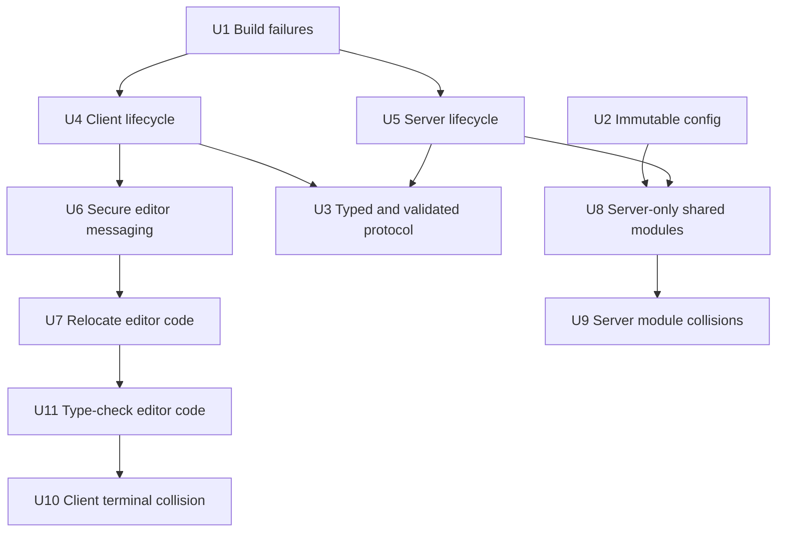

# Refactor: Harden Runtime Boundaries and Lifecycle Ownership

## Overview

Strengthen WeTTY's build reliability, runtime lifecycle management, and
client/server architecture without changing its public package entrypoint, CLI
flags, or Socket.IO wire behavior. The work starts with independently shippable
correctness fixes, then introduces a typed protocol boundary, and finishes by
clarifying source ownership so executable browser code is no longer treated as a
static asset.

This plan consolidates the original codebase review findings with the follow-up
client/server separation review.

---

## Problem Frame

The repository has a sound top-level browser/server split: production imports do
not cross directly between `src/client/` and `src/server/`, the browser
TypeScript project includes only `src/client/`, and the Node project excludes
it. The main weaknesses sit at the boundaries and lifecycles:

- `pnpm build` can exit successfully after browser or server TypeScript
  failures.
- Browser reconnects create additional terminal sessions and event handlers
  without disposing the previous session.
- Server socket, PTY, login, metrics, and listener cleanup responsibilities are
  spread across modules.
- Configuration loading mutates exported default objects.
- Socket.IO event names and payloads are duplicated rather than expressed as one
  shared contract.
- The configuration editor is executable browser code under `src/assets/`,
  outside normal TypeScript and ESLint ownership.
- `src/shared/`, `src/server/shared/`, root `src/server.ts`, and repeated
  file-plus-directory names obscure module ownership.

---

## Requirements Trace

- R1. `pnpm build` and CI must fail whenever browser or server TypeScript
  compilation fails.
- R2. Every configuration load must start from immutable defaults and remain
  independent of previous loads.
- R3. The browser must own at most one active terminal session after initial
  connection or reconnection.
- R4. Each server connection must have deterministic, idempotent cleanup for
  PTYs, socket listeners, timers, and connection metrics.
- R5. Client-to-server and server-to-client Socket.IO events must share one
  compile-time contract, and client-originated payloads must be validated at the
  server boundary without changing valid event names or payloads.
- R6. Configuration-editor messages must accept only the expected window and
  origin, including when WeTTY is embedded under `allowIframe`.
- R7. Executable configuration-editor code must be linted, type-checked, and
  owned by the client source tree; `src/assets/` must contain static resources
  plus only explicitly managed standalone runtime assets such as the service
  worker.
- R8. Source directories and module names must communicate ownership while
  preserving the published `./build/server.js` package export and
  `./build/main.js` CLI entrypoint.
- R9. Regression coverage must exercise build failure propagation, configuration
  isolation, reconnect cleanup, server disconnect cleanup, metrics accounting,
  and message validation.

---

## Scope Boundaries

- Do not change CLI flags, environment-variable names, or configuration-file
  syntax.
- Do not change Socket.IO event names or on-wire payload shapes.
- Do not change the package export path (`./build/server.js`) or CLI binary path
  (`./build/main.js`).
- Do not redesign the terminal UI or configuration-editor experience.
- Do not replace Socket.IO, xterm.js, Express, or node-pty.
- Do not combine directory moves with unrelated feature work.

---

## Context & Research

### Relevant Code and Patterns

- `build.js` owns browser bundling and both browser/server TypeScript checks.
- `.github/workflows/build-and-test.workflow.yml` treats `pnpm build` as the
  compile gate.
- `src/client/wetty.ts` initializes each browser terminal session from
  Socket.IO's recurring `connect` event.
- `src/client/wetty/term/configuration.ts` registers iframe, window, and
  document listeners.
- `src/server.ts`, `src/server/login.ts`, and `src/server/spawn.ts` currently
  divide server connection lifecycle ownership.
- `src/shared/config.ts` merges config-file values with exported objects from
  `src/shared/defaults.ts`.
- `src/assets/xterm_config/` contains an executable configuration-editor
  application despite the ESLint exclusion for `src/assets/**`.

### Verified Baseline

- ESLint passes.
- 75 Mocha tests pass.
- Direct browser and server `tsc --noEmit` checks pass.
- The current production build passes.
- A controlled temporary-copy probe confirmed that browser and server TypeScript
  errors both leave `pnpm build` with exit code 0.
- A sequential-load probe confirmed that `loadConfigFile` carries a previous
  config's SSH port into the next load.
- There are no runtime import cycles and no direct client/server production
  imports.

### External References

External research is not required. The repository already contains the relevant
Socket.IO, build, lifecycle, and test patterns, and the planned work does not
introduce a new framework or external contract.

---

## Key Technical Decisions

- Keep `src/client/` and `src/server/` as the primary runtime boundary; improve
  the seams rather than performing a wholesale rewrite.
- Add a small runtime-neutral protocol module for Socket.IO event interfaces;
  avoid moving server configuration or logger code into that module.
- Give each client or server session one owner that returns or invokes an
  idempotent disposer.
- Use named event handlers so cleanup removes only listeners owned by that
  session; prohibit broad `removeAllListeners` cleanup.
- Preserve package output paths through compatibility entry modules while
  internal files move.
- Sequence verified build/config fixes first, then lifecycle ownership, then
  protocol consolidation, and only then directory moves.
- Add characterization coverage before changing reconnect and server-session
  lifecycle code.
- Treat compile-time Socket.IO types and runtime payload validation as
  complementary boundary controls.
- Preserve cross-origin embedding when `allowIframe` is enabled while
  restricting editor messages to the same-origin editor iframe.

---

## High-Level Technical Design

> _This illustrates the intended approach and is directional guidance for
> review, not implementation specification. The implementing agent should treat
> it as context, not code to reproduce._

### Delivery sequence

---

## Implementation Units

- [x] U1. **Make build failures authoritative**

**Goal:** Ensure every child-process, browser type-check, server type-check, and
esbuild failure makes `pnpm build` exit non-zero.

**Requirements:** R1, R9

**Dependencies:** None

**Files:**

- Modify: `build.js`
- Modify: `.github/workflows/build-and-test.workflow.yml` only if an explicit
  type-check defense-in-depth step remains useful after the build fix
- Create: `src/build.spec.ts`

**Approach:**

- Make child-process completion reject on spawn errors, signals, or non-zero
  exits.
- Let browser type-check rejection surface as an esbuild build error rather than
  a warning.
- Await non-watch esbuild completion.
- Keep watch mode long-running without treating the watcher startup as a
  completed build.
- Make the testable process helper importable without executing the full build
  as an import side effect.

**Execution note:** Start with regression coverage for zero and non-zero
child-process exits, then repeat the controlled browser/server type-error
probes.

**Patterns to follow:**

- Existing child-process assertions in `src/main.spec.ts`.

**Test scenarios:**

- Happy path: a child process exits 0 and its completion promise resolves.
- Error path: a child process exits with a non-zero code and the completion
  promise rejects with command and exit context.
- Error path: a nonexistent executable emits a spawn error and the completion
  promise rejects.
- Integration: an injected browser TypeScript error makes `pnpm build` exit
  non-zero in an isolated fixture.
- Integration: an injected server TypeScript error makes `pnpm build` exit
  non-zero in an isolated fixture.
- Watch mode: both initial browser/server compilations complete, the process
  remains alive, one source change rebuilds each project, and controlled
  shutdown leaves no child process behind.

**Verification:**

- A clean build still succeeds.
- Both controlled type-error probes fail the build.
- Watch mode remains alive after startup and propagates watcher failure or
  termination.
- CI cannot report a successful compile after either TypeScript project fails.

---

- [ ] U2. **Make configuration merging immutable**

**Goal:** Prevent one config load or caller mutation from changing defaults used
by future loads.

**Requirements:** R2, R9

**Dependencies:** None

**Files:**

- Modify: `src/shared/config.ts`
- Modify: `src/shared/defaults.ts` if readonly typing is introduced
- Test: `src/shared/config.spec.ts`

**Approach:**

- Replace mutation of exported defaults with fresh object merges.
- Return fresh nested objects when no config file is supplied.
- Clone mutable nested values, especially `server.allowedOrigins`, instead of
  relying on shallow spreads.
- Preserve the current precedence: CLI values override config-file values, which
  override environment-derived defaults.

**Execution note:** Add the sequential-load regression before changing merge
behavior.

**Test scenarios:**

- Happy path: one config file overrides an SSH and server value without changing
  unrelated defaults.
- Regression: a second config load does not inherit values unique to the first
  load.
- Edge case: a caller mutating scalar fields on a returned config does not alter
  the next returned config.
- Edge case: pushing into one result's `server.allowedOrigins` does not change
  exported defaults or a later result.
- Integration: CLI-over-config precedence remains unchanged after immutable
  merging.

**Verification:**

- Sequential loads are independent.
- Existing config and defaults tests remain green.

---

- [ ] U4. **Give the browser session deterministic cleanup**

**Goal:** Keep exactly one active terminal and one set of socket/DOM handlers
across reconnects.

**Requirements:** R3, R9

**Dependencies:** U1

**Files:**

- Modify: `src/client/wetty.ts`
- Modify: `src/client/wetty/term.ts`
- Modify: `src/client/wetty/term/configuration.ts`
- Modify: `src/client/wetty/mobile.ts` if setup participates in disposal
- Create: `src/client/wetty/session.ts`
- Create or modify: `src/client/wetty.spec.ts`

**Approach:**

- First extract a side-effect-free session factory behind injected socket,
  terminal, and DOM dependencies so Mocha can test it without importing SCSS or
  booting the browser entrypoint.
- Give each session an idempotent disposer and register socket and DOM handlers
  as named callbacks.
- Dispose the old session before creating a new one on `connect`.
- Remove owned listeners, cancel pending resources, dispose xterm, and clear
  global references during teardown.
- Register application-lifetime listeners once outside the recurring connection
  callback when appropriate.
- Preserve visible state transitions: disconnect reason appears in the overlay,
  successful reconnect hides it and focuses the replacement terminal, and
  terminal-creation failure leaves an actionable disconnected state.
- Keep an open configuration editor open across reconnect and rebind it to the
  replacement terminal; subsequent saves must affect only the replacement
  session.

**Execution note:** Characterize two consecutive connect cycles and visible
overlay/focus behavior against the extracted session seam before changing
listener ownership.

**Test scenarios:**

- Happy path: first connect creates one terminal session and one handler set.
- Reconnect: second connect disposes the first terminal before activating the
  second.
- Regression: one server `data` event produces one terminal write after multiple
  reconnects.
- Regression: resize and commit emissions occur once per triggering action after
  reconnect.
- Visible state: disconnect shows the supplied reason, successful reconnect
  clears the overlay and focuses the new terminal, and terminal-creation failure
  keeps the overlay visible.
- Editor state: an editor open during reconnect stays open, rebinds, and updates
  only the replacement terminal.
- Stale authority: retained callbacks from the disposed session cannot write,
  emit, alter editor state, or dispose resources owned by the replacement
  session.
- Edge case: repeated disposal is harmless.

**Verification:**

- Listener counts remain stable after repeated reconnects.
- Delayed callbacks from a disposed session are inert.
- Visible disconnect/reconnect/editor behavior remains deterministic.

---

- [ ] U5. **Centralize server connection lifecycle**

**Goal:** Ensure PTYs, temporary login listeners, session listeners, timers, and
metrics are acquired and released exactly once.

**Requirements:** R4, R9

**Dependencies:** U1

**Files:**

- Modify: `src/server.ts`
- Modify: `src/server/login.ts`
- Modify: `src/server/spawn.ts`
- Modify: `src/server/flowcontrol.ts`
- Create: `src/server/session.ts`
- Create or modify: `src/server.spec.ts`
- Modify: `src/server/socketServer/socket.spec.ts` if connection-level
  integration belongs there

**Approach:**

- Introduce one per-socket lifecycle owner with named handlers, idempotent
  cleanup, a completion signal, and explicit session-end reasons.
- Have the outer connection handler await session completion and decrement the
  active-connection gauge in one `finally` path.
- Remove temporary login listeners when login resolves, rejects, or disconnects.
- Replace broad `removeAllListeners` calls with removal of only handlers owned
  by the session.
- Give buffered/timed senders a cancellation or finalization path.
- Track disposed/aborted state and check it after every asynchronous acquisition
  before installing listeners, emitting events, or publishing a PTY.
- Define PTY teardown so late data/exit events are inert and termination failure
  cannot reactivate a disposed session.

**Execution note:** Add characterization coverage for login-to-session handoff
and normal disconnect before moving cleanup responsibilities.

**Test scenarios:**

- Happy path: login handoff removes temporary input and disconnect listeners
  before the main PTY session starts.
- Disconnect: a normal disconnect kills the active PTY, removes owned listeners,
  cancels pending sends, and decrements the gauge once.
- Error path: command generation or PTY startup failure performs the same
  cleanup and metric decrement.
- Startup race: disconnect during login, after command generation, or during PTY
  startup prevents any later continuation from publishing a PTY, listener, or
  payload.
- PTY teardown: disposal requests termination once; late PTY data cannot emit,
  and late socket input cannot write to the PTY.
- Edge case: PTY exit followed by socket disconnect does not double-clean or
  produce a negative gauge.
- Isolation: session cleanup does not remove listeners registered by unrelated
  Socket.IO components.

**Verification:**

- No connection path relies on `removeAllListeners`.
- Active-connection metrics return to baseline after normal, failing, and
  startup-race sessions.
- Session completion settles once for PTY exit, socket disconnect, login
  rejection, spawn failure, and repeated disposal.

---

- [ ] U3. **Define and validate the Socket.IO protocol boundary**

**Goal:** Give browser and server code one compile-time source of truth for
events while rejecting malformed client-originated payloads before they reach
PTY or flow-control state.

**Requirements:** R5, R8, R9

**Dependencies:** U4, U5

**Files:**

- Create: `src/protocol/socket-events.ts`
- Create: `src/protocol/socket-events.spec.ts`
- Modify: `src/client/wetty/socket.ts`
- Modify: `src/client/wetty.ts`
- Modify: `src/client/wetty/term.ts`
- Modify: `src/server.ts`
- Modify: `src/server/login.ts`
- Modify: `src/server/spawn.ts`
- Modify: `src/server/flowcontrol.ts`
- Modify: `src/server/socketServer/socket.ts`
- Test: `src/server/socketServer/socket.spec.ts`

**Approach:**

- Define separate client-to-server and server-to-client interfaces in a
  runtime-neutral module.
- Parameterize Socket.IO client, server, and socket types with those interfaces.
- Preserve existing event strings and valid payload shapes exactly.
- Add narrow runtime decoders and bounds for client-originated input, resize,
  and flow-control payloads before state mutation or PTY access.
- Keep connection-internal framework events separate from application protocol
  events where the Socket.IO types require it.
- Lock the current event inventory as a compatibility contract so coordinated
  client/server edits cannot silently break external or version-skewed clients.

**Test scenarios:**

- Compile-time: all current event registrations and emissions satisfy the shared
  interfaces in both TypeScript projects.
- Compatibility: literal event names and representative valid payloads remain
  `input`, `resize`, `commit`, `data`, `login`, and `logout`.
- Runtime error: an untyped client sending wrong types, missing fields, invalid
  dimensions, negative commits, or oversized input is rejected before PTY or
  flow-control interaction.
- Regression: valid existing clients retain current wire behavior and existing
  socket tests pass.

**Verification:**

- No production application event remains duplicated without a shared type
  declaration.
- Browser and server type checks pass against the same protocol module.
- Malformed client payloads cannot reach PTY or flow-control operations.

---

- [ ] U6. **Validate configuration-editor messaging**

**Goal:** Restrict editor communication to the expected same-origin
parent/iframe pair while preserving supported WeTTY embedding.

**Requirements:** R6, R9

**Dependencies:** U4

**Files:**

- Modify: `src/client/wetty/term/configuration.ts`
- Modify: `src/assets/xterm_config/functionality.js` before its U7 move
- Modify: `src/assets/xterm_config/functionality.spec.ts`
- Create or modify: `src/client/wetty/term/configuration.spec.ts`

**Approach:**

- Send messages to the application origin instead of `*`.
- Validate both `event.origin` and `event.source` before reading message data.
- Reject malformed message payloads at the boundary.
- Preserve cross-origin embedding of the outer WeTTY page when `allowIframe` is
  enabled; only the same-origin configuration-editor iframe may participate in
  the editor channel.
- Preserve current editor semantics for initial load, automatic valid saves,
  invalid JSON, apply failures, recovery, persistence, and close.

**Test scenarios:**

- Happy path: the expected iframe and origin can load, save, persist, and close.
- Embedding: WeTTY nested in a foreign-origin outer frame still communicates
  only with its own same-origin editor iframe.
- Security: a trusted origin with the wrong source window is ignored.
- Security: the expected window with a foreign origin is ignored.
- Error path: malformed or unknown messages do not change terminal options,
  persistence, or menu state.
- Editor behavior: invalid JSON does not save; apply failure shows the existing
  error state; corrected input clears the error and saves once.

**Verification:**

- No configuration-editor `postMessage` call uses a wildcard target.
- Both receiving windows validate origin and source.
- Root, non-root base-path, and embedded deployments preserve the editor flow.

---

- [ ] U7. **Relocate executable editor code without behavior changes**

**Goal:** Move configuration-editor application code under explicit client
ownership while preserving its classic-script behavior and served paths.

**Requirements:** R7, R8, R9

**Dependencies:** U6

**Files:**

- Create: `src/client/config-editor/`
- Move: `src/assets/xterm_config/functionality.js`
- Move: `src/assets/xterm_config/xterm_advanced_options.js`
- Move: `src/assets/xterm_config/xterm_color_theme.js`
- Move: `src/assets/xterm_config/xterm_defaults.js`
- Move: `src/assets/xterm_config/xterm_general_options.js`
- Move: `src/assets/xterm_config/functionality.spec.ts`
- Move or retain as a build input: `src/assets/xterm_config/index.html`
- Modify: `build.js`
- Modify: `eslint.config.mjs`

**Approach:**

- Move executable editor modules and tests unchanged before language conversion.
- Update build copy inputs while preserving
  `${base}/client/xterm_config/index.html` for root and non-root deployments.
- Include moved JavaScript in ESLint; narrow the blanket `src/assets/**`
  exclusion and give the standalone service worker an explicit lint policy.
- Leave icons, styles, manifest data, and other immutable resources in
  `src/assets/`.
- Make non-watch builds clear `build/` once before generating outputs so stale
  files cannot mask missing moved assets; do not clear outputs during watch
  rebuilds.

**Execution note:** Treat this as a behavior-preserving relocation. U11 owns
TypeScript conversion and bundling.

**Test scenarios:**

- Happy path: the editor loads under root and non-empty base paths and
  round-trips options.
- Regression: a clean build contains every editor HTML, CSS, and script
  dependency in the existing served location.
- Integration: the parent page and relocated editor exchange validated messages.
- Static analysis: moved executable modules and the standalone service worker
  run through intentional ESLint configurations.

**Verification:**

- No configuration-editor application logic remains under `src/assets/`.
- A clean build, not a reused output tree, serves the editor at its existing
  base-prefixed URL.

---

- [ ] U11. **Convert the configuration editor to a typed bundle**

**Goal:** Type-check the editor and replace implicit classic-script globals with
one ordered client entrypoint.

**Requirements:** R7, R9

**Dependencies:** U7

**Files:**

- Create: `src/client/config-editor/index.ts`
- Convert: `src/client/config-editor/*.js` to TypeScript modules
- Modify: `src/client/config-editor/index.html`
- Modify: `build.js`
- Modify: `tsconfig.browser.json` only if the existing client include does not
  cover the new entrypoint
- Test: `src/client/config-editor/functionality.spec.ts`

**Approach:**

- Create one editor entrypoint that imports functionality, option definitions,
  and defaults in the current required initialization order.
- Replace implicit `window` globals with explicit module exports and imports.
- Bundle the entrypoint to the existing editor script location so the served
  HTML contract remains stable.
- Keep the existing option schema and behavior; this unit changes ownership and
  typing, not editor features.

**Test scenarios:**

- Happy path: the built editor renders every option group and loads existing
  stored options.
- Ordering: defaults apply only after every option definition is registered.
- Integration: built-page load/save/close messaging works with the parent
  terminal page.
- Type safety: editor option and message shapes participate in the browser
  TypeScript check.

**Verification:**

- No configuration-editor executable module is excluded from browser
  type-checking.
- The built editor no longer depends on implicit global initialization order.

---

- [ ] U8. **Move server-only modules out of generic shared ownership**

**Goal:** Reserve cross-runtime ownership for protocol contracts and place
config, defaults, environment, and logging under server-owned modules.

**Requirements:** R8

**Dependencies:** U2, U5

**Files:**

- Preserve compatibility facade: `src/server.ts`
- Reorganize: `src/shared/config.ts`, `src/shared/defaults.ts`,
  `src/shared/env.ts`, `src/shared/interfaces.ts`, `src/shared/logger.ts`
- Reorganize: `src/server/shared/`
- Modify: `docs/development.md`
- Test: affected `src/**/*.spec.ts` suites

**Approach:**

- Move server configuration and environment modules to a server-owned config
  area.
- Move logger code to a server observability area.
- Move PTY/input/log-safety helpers to their owning server features.
- Keep only runtime-neutral Socket.IO contracts under `src/protocol/`.
- Preserve `src/server.ts` as the source compatibility facade for
  `build/server.js`.

**Test scenarios:**

- Compile-time: the Node project resolves every moved import and the browser
  project does not acquire server dependencies.
- Regression: config, defaults, logging, command, and socket tests pass after
  moves.
- Public API: the compatibility facade exports the same symbols.

**Verification:**

- No server-only module remains under `src/shared/`.
- Runtime boundary imports remain one-way and cycle-free.

---

- [ ] U9. **Resolve server file-and-directory collisions**

**Goal:** Make command, spawn, and socket-server features navigable without
changing their public behavior or package output.

**Requirements:** R8

**Dependencies:** U3, U8

**Files:**

- Reorganize: `src/server/command.ts` and `src/server/command/`
- Reorganize: `src/server/spawn.ts` and `src/server/spawn/`
- Reorganize: `src/server/socketServer.ts` and `src/server/socketServer/`
- Preserve compatibility facade: `src/server.ts`
- Modify: `build.js` only if entry mapping requires it
- Test: affected `src/server/**/*.spec.ts` suites

**Approach:**

- Give each server feature directory an explicit entry module and move
  implementation beneath it.
- Keep package-facing exports in `src/server.ts`; do not change `package.json`
  export or binary paths.
- Keep this unit move-focused and exclude cosmetic symbol renames.

**Test scenarios:**

- Compile-time: all server imports resolve after each feature move.
- Regression: command generation, PTY spawning, metrics, and socket behavior
  remain unchanged.
- Clean package: after deleting `build/`, build and pack the project, install
  the tarball in a temporary project, import the public API, and run the
  installed CLI help path.

**Verification:**

- The generated package still exposes `./build/server.js` and `./build/main.js`.
- A clean packed artifact contains no stale pre-move modules required for
  success.

---

- [ ] U10. **Resolve the client terminal file-and-directory collision**

**Goal:** Place terminal session, controls, and configuration modules under one
clear client feature directory.

**Requirements:** R8

**Dependencies:** U4, U11

**Files:**

- Reorganize: `src/client/wetty/term.ts` and `src/client/wetty/term/`
- Modify: `src/client/wetty.ts`
- Test: `src/client/wetty.spec.ts`
- Test: affected `src/client/**/*.spec.ts` suites

**Approach:**

- Create an explicit terminal feature entry module.
- Keep session ownership, terminal controls, and configuration concerns in
  distinct modules beneath the feature directory.
- Preserve current browser bundle entrypoints and global compatibility hooks
  until callers are migrated.

**Test scenarios:**

- Compile-time: browser imports resolve with no runtime cycle.
- Regression: terminal creation, controls, reconnect cleanup, editor messaging,
  and downloads retain behavior.
- Clean package: a clean build contains the expected browser and editor bundles
  without obsolete pre-move paths.

**Verification:**

- The client terminal feature has one unambiguous entry module.
- Runtime imports remain cycle-free and browser behavior tests pass.

---

## System-Wide Impact

- **Interaction graph:** Build orchestration, browser Socket.IO callbacks, xterm
  lifecycle, iframe messaging, server Socket.IO callbacks, node-pty lifecycle,
  and Prometheus metrics are affected.
- **Error propagation:** Build subprocess failures become fatal; runtime session
  cleanup remains best-effort and idempotent without hiding the original
  failure.
- **State lifecycle risks:** Duplicate listeners, stale terminal references,
  pending timers, mutable defaults, and double metric decrements require
  explicit regression coverage.
- **API surface parity:** Socket.IO event types must be applied to client and
  server together. Internal module moves must preserve package exports and CLI
  output paths.
- **Integration coverage:** Reconnect, login handoff, normal disconnect, failure
  cleanup, editor messaging, and isolated build fixtures cross multiple modules
  and require integration tests.
- **Unchanged invariants:** Current CLI flags, environment variables, config
  syntax, event names, wire payloads, public exports, and served editor URL
  remain stable.

---

## Phased Delivery

### Phase 1 — Reliability foundations

- U1 build failure propagation
- U2 immutable configuration

### Phase 2 — Lifecycle ownership and protocol boundary

- U4 browser session lifecycle
- U5 server connection lifecycle
- U3 shared and runtime-validated Socket.IO protocol

### Phase 3 — Browser boundary cleanup

- U6 validated editor messaging
- U7 behavior-preserving editor relocation
- U11 typed editor bundle

### Phase 4 — Low-risk structural consolidation

- U8 server-only shared-module ownership
- U9 server feature entry modules
- U10 client terminal feature entry module

---

## Risks & Dependencies

| Risk                                                                | Mitigation                                                                                                      |
| ------------------------------------------------------------------- | --------------------------------------------------------------------------------------------------------------- |
| Broad lifecycle refactors alter event ordering                      | Characterize current flows first; land client and server lifecycle work separately                              |
| Protocol work accidentally changes valid wire behavior              | Lock literal event names and representative payloads; validate malformed inputs without changing valid clients  |
| Editor move breaks copied asset paths or base-prefixed deployments  | Preserve `${base}/client/xterm_config/index.html` and verify clean generated output for root and non-root bases |
| Directory churn obscures behavior changes                           | Complete behavioral fixes first and split ownership, server entrypoints, and client entrypoints across U8-U10   |
| Cleanup runs more than once                                         | Require idempotent disposers and explicit double-clean tests                                                    |
| Package consumers depend on `build/server.js`                       | Preserve `src/server.ts` as a compatibility facade and test a clean installed package tarball                   |
| Build regression tests become slow                                  | Unit-test process failure semantics; keep full injected-error and watch probes targeted                         |
| Disconnect races publish resources after cleanup                    | Track disposed state across asynchronous boundaries and test each startup race                                  |
| Classic editor script ordering is lost during TypeScript conversion | Use one ordered editor entrypoint and a built-page integration test                                             |

---

## Progress Log

- 2026-10-24: Plan created from codebase review and client/server separation
  analysis.
- 2026-10-24: Baseline verified: lint clean, 75 tests passing, direct
  browser/server type checks clean, build passing, working tree clean.
- 2026-10-24: Multi-perspective plan review applied sequencing, lifecycle
  cancellation, editor build, non-root URL, clean-package, and scope corrections
  before implementation.
- 2026-10-24: U1 completed. Child-process failures now reject, browser
  type-check failures are esbuild errors, non-watch esbuild is awaited, and the
  build entrypoint is safe to import for tests. Verified with 78 passing tests,
  clean lint/type checks, successful production and watch builds, and isolated
  browser/server type-error probes that both exit non-zero.

---

## Sources & References

- Build orchestration: `build.js`
- CI compile gate: `.github/workflows/build-and-test.workflow.yml`
- Browser entry and lifecycle: `src/client/wetty.ts`
- Terminal/configuration lifecycle: `src/client/wetty/term.ts`,
  `src/client/wetty/term/configuration.ts`
- Server composition and lifecycle: `src/server.ts`, `src/server/login.ts`,
  `src/server/spawn.ts`
- Configuration defaults and merging: `src/shared/defaults.ts`,
  `src/shared/config.ts`
- Existing protocol call sites: `src/client/wetty.ts`, `src/server/spawn.ts`,
  `src/server/flowcontrol.ts`
- Configuration editor: `src/assets/xterm_config/`
- Published package contract: `package.json`
